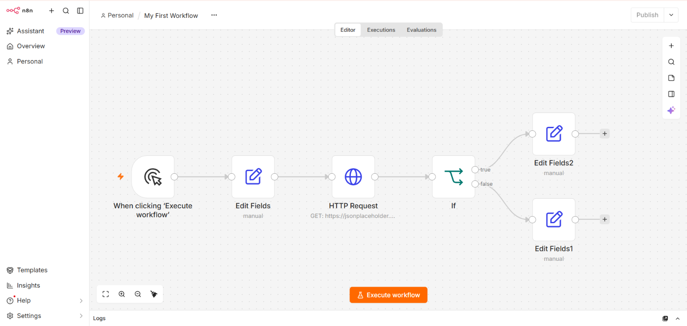
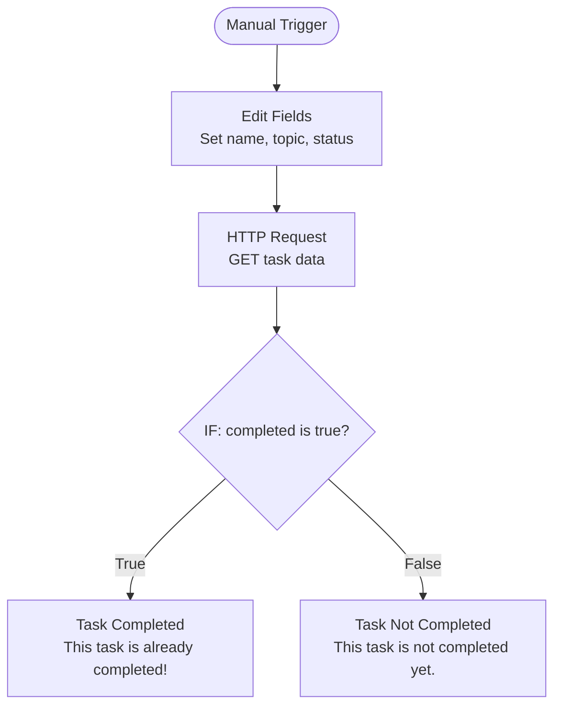

# My First n8n Project 🚀 — Todo Status Checker

My first hands-on project while learning **n8n and workflow automation**. This workflow calls a public REST API, checks whether a task is completed, and routes the result into a True or False branch.

## 📸 Workflow Screenshot

The workflow below was built and tested locally using n8n.

## 🔀 Workflow Flow Diagram

This diagram shows how data moves through the workflow.

## 🧩 How It Works

1. **Manual Trigger** — starts the workflow when I click **Execute workflow**.
2. **Edit Fields** — sets sample fields such as `name`, `topic`, and `status`.
3. **HTTP Request** — sends a GET request to the JSONPlaceholder API.
4. **IF Node** — checks whether the API response's `completed` field is the Boolean value `true`.
5. **True branch** — returns a message that the task is already completed.
6. **False branch** — returns a message that the task is not completed yet.

## 🌐 API Used

**Endpoint:** https://jsonplaceholder.typicode.com/todos/4

This is a public sample API from JSONPlaceholder. The returned task has a `completed` field that the IF node evaluates.

## 🛠️ Technologies Used

- [n8n](https://n8n.io/) — workflow automation
- Docker Desktop — running n8n locally
- REST API and HTTP GET
- JSON
- Git and GitHub

## ▶️ How to Import and Run

1. Start your local n8n instance.
2. Open the n8n editor.
3. Use the workflow menu to import `todo-status-checker.json` from your computer.
4. Open the imported workflow.
5. Click **Execute workflow**.
6. Inspect the HTTP Request response and the IF node's True/False output.

> **Note:** This workflow uses a public demo API and does not require API credentials.

## 📚 What I Learned

- Building a workflow with a Manual Trigger
- Configuring Edit Fields
- Sending HTTP GET requests
- Reading JSON API responses
- Checking Boolean values in an IF node
- Routing workflow execution through True and False branches
- Exporting and version-controlling an n8n workflow with Git and GitHub

## 🚀 Future Improvements

- Add a Schedule Trigger to run automatically.
- Send a notification based on the task status.
- Explore more public APIs and build additional workflows.

---

**Learning journey:** This is my first n8n project. I plan to keep building and sharing more practical workflow automation projects as I learn.
